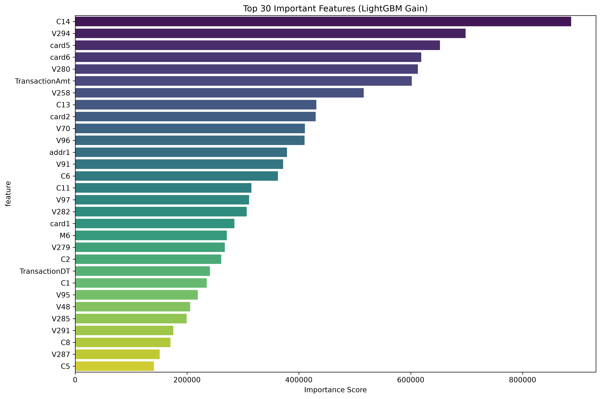

# IEEE-CIS Fraud Detection

An end-to-end machine learning project for identifying fraudulent online transactions. The project combines an auditable preprocessing pipeline, an imbalance-aware LightGBM classifier, and a Streamlit interface for interactive, real-time risk scoring.

> **Portfolio project:** designed to demonstrate an applied ML workflow. It is not a production fraud-decisioning system and should not be used to approve or decline real transactions.

## Highlights

- Builds a reusable training pipeline from raw IEEE-CIS transaction and identity data.
- Handles missing values, categorical encoding, scaling, and time-based feature engineering.
- Addresses class imbalance with SMOTE and LightGBM class weighting.
- Persists the fitted model and preprocessing state for consistent inference.
- Provides a polished Streamlit dashboard with risk probabilities and global feature-importance context.

## Dashboard

The interface accepts a small set of transaction attributes, supplies the remaining model inputs from the fitted preprocessing state, and returns a fraud probability, confidence score, and relevant feature-importance signals.

<p align="center">
  
</p>

## Tech stack

Python · Pandas · Scikit-learn · LightGBM · imbalanced-learn · Streamlit · Plotly · SHAP

## Evaluation snapshot

The notebook records a five-fold out-of-fold ROC-AUC of **0.96637**. At a 0.50 decision threshold, the fraud class achieved **80% recall** and an **F1 score of 0.37**. The relatively low fraud precision reflects the deliberately recall-oriented threshold and the dataset's strong class imbalance; a production deployment should tune this threshold to its false-positive-cost tolerance.

## Repository structure

```text
.
├── app.py                  # Streamlit dashboard
├── src/
│   ├── config.py           # Paths, model settings, and dashboard fields
│   ├── data_loader.py      # Dataset loading and merging
│   ├── preprocessing.py    # Feature preparation and artifact persistence
│   ├── train.py            # Training, evaluation, and reporting
│   ├── predict.py          # Inference service
│   └── main.py             # Optional FastAPI entry point
├── reports/                # Versioned evaluation visuals
├── frontend/               # Static client for the FastAPI endpoint
├── data/                   # Local-only Kaggle data (ignored by Git)
└── models/                 # Local-only trained artifacts (ignored by Git)
```

## Getting started

### 1. Create an environment and install dependencies

```bash
python -m venv .venv
.venv\Scripts\activate
pip install -r requirements.txt
```

On macOS or Linux, activate the environment with `source .venv/bin/activate`.

### 2. Download the data

Download the [IEEE-CIS Fraud Detection dataset](https://www.kaggle.com/competitions/ieee-fraud-detection/data) from Kaggle and place these files in `data/`:

```text
data/train_transaction.csv
data/train_identity.csv
```

The dataset is not included in this repository. Please comply with Kaggle's terms of use before downloading or redistributing it.

### 3. Train the model

```bash
python -m src.train
```

Training generates the model and preprocessing artifacts in `models/`. These files are deliberately excluded from version control.

### 4. Run the dashboard

```bash
streamlit run app.py
```

### 5. Run checks

```bash
python -m unittest discover -s tests -v
```

### Optional: run the API and static client

```bash
uvicorn src.main:app --reload
```

## Method

1. Merge transaction and identity records using `TransactionID`.
2. Engineer temporal features from `TransactionDT`.
3. Impute missing numeric and categorical values; label-encode categoricals and standardize numeric features.
4. Split the data with stratification, then apply SMOTE only to the training partition.
5. Train LightGBM with early stopping and class weighting.
6. Evaluate with ROC-AUC, F1 score, ROC curves, and feature importance.

## Data and model artifacts

Raw data, trained model files, virtual environments, and local secrets are ignored through `.gitignore`. This keeps the repository lightweight, avoids publishing data that is subject to third-party terms, and makes the project reproducible from documented steps.

## License

Distributed under the [MIT License](LICENSE). The IEEE-CIS dataset remains subject to its own Kaggle terms.
